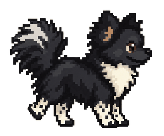
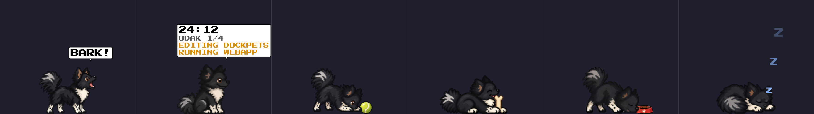
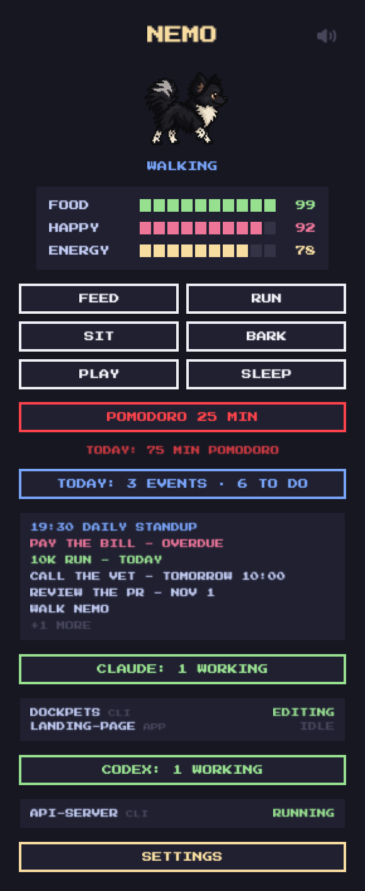
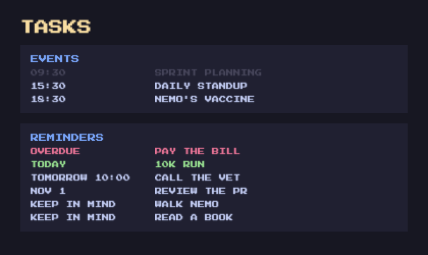
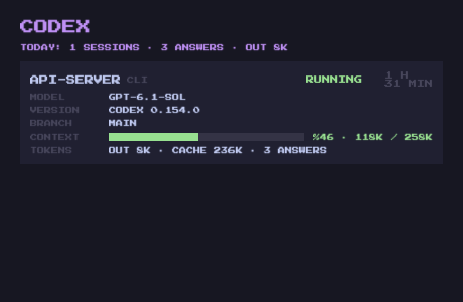
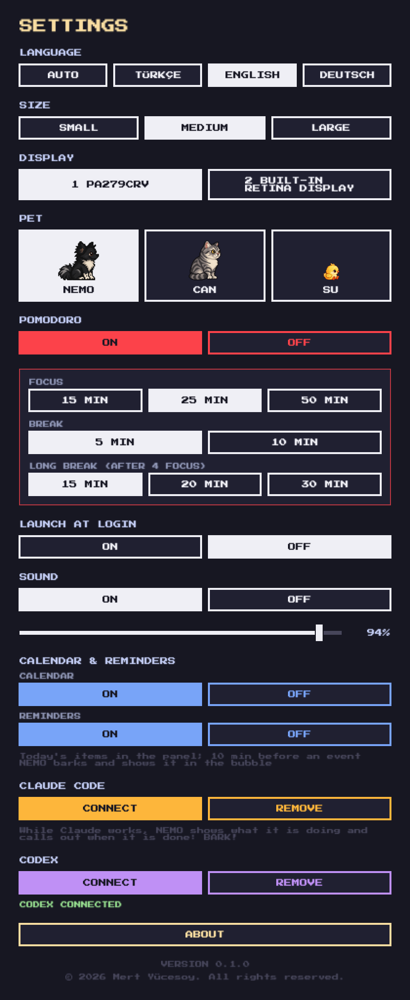
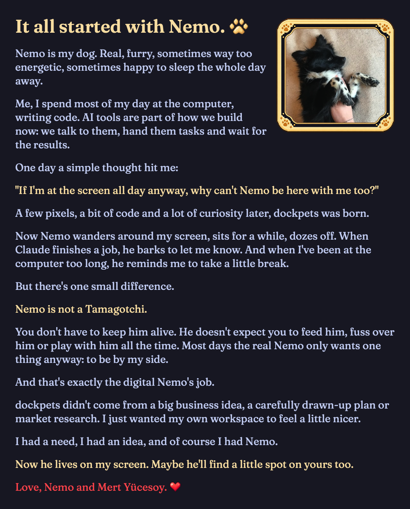

# dockpets 🐾

**A pixel-art companion that lives on top of your Dock while you build with AI.**

  

dockpets began with Nemo, my dog. Most of my day goes into the terminal, giving Claude tasks and waiting for the
results, and one day I wondered: if I'm at the screen all day anyway, why can't Nemo be here with me too? So I drew
her pixel by pixel and put her on top of the Dock.

She is not a Tamagotchi. You don't have to keep her alive or feed her. Her only job is to be there. She walks while
Claude works, barks when a task is done, and reminds you to take a break.

  

## Features

- **Reacts to Claude Code.** Nemo walks while a session works, and her bubble says what it is doing (`EDITING`,
  `RUNNING`…). When a session finishes she barks with the project's name. When Claude waits for you, she asks `?`.
  It works with several sessions at once, in the terminal, the Claude desktop app's Code tab or an IDE extension
  (local sessions; not the chat or Claude Code on the web).
- **Codex too.** Connect Codex in settings, and Nemo reacts to its sessions the same way. A purple CODEX button
  lists them, and its window shows each session's model, context and tokens.
- **Where each session runs.** A small `CLI` / `APP` / `IDE` tag next to every session.
- **Claude window.** One card per open session: the model, the context bar, tokens and a cost estimate, plus
  today's summary across every session.
- **Pomodoro.** Focus and breaks, with the countdown in her bubble next to what Claude is doing, and today's minutes
  in the panel.
- **Today's calendar and reminders.** Today's events and open reminders in the menu bar, Google Calendar included
  through macOS Calendar. 10 minutes before a meeting she barks and keeps it in her bubble.
- **Three pets.** Nemo the Pomeranian, CAN the British Shorthair and Su the chick, each with their own walk, sound
  and games: a tennis ball, a yarn ball, a bowl, a bone.
- **Stats without guilt.** Food, happiness and energy only change her mood. Nothing bad happens if you forget her.
- **Turkish, English and German.**

| Menu bar panel | Tasks window | Codex window | Settings | About |
|---|---|---|---|---|
|  |  |  |  |  |

## Built with

- Swift, AppKit and SwiftUI, with no third-party dependencies
- EventKit for Calendar and Reminders
- Claude Code and Codex hooks and transcripts for the live session status
- Hand-tuned pixel-art sprite sheets, the Press Start 2P and Fraunces fonts, and Nemo's real bark

## Download

Coming soon for macOS 13 and later: a signed and notarized app with a free trial.

The source code is private. This repository is a showcase.

© 2026 Mert Yücesoy
